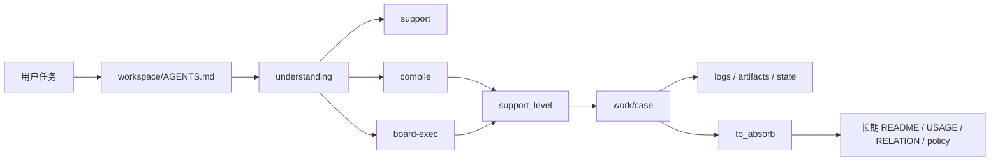
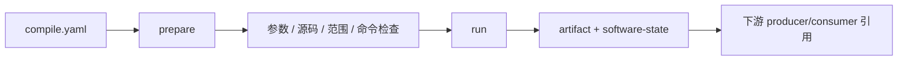

# NXP_v2 工作空间 PPT 梳理与讲解脚本

## 1. 文档用途

这份文档用于制作一份 10～15 分钟的简单 PPT，向嵌入式开发、
技术支持或 AI 工程相关人员介绍 `NXP_v2` 工作空间。

介绍范围以 GitHub 轻量仓库中的内容为主，但会说明它如何指向本地
的源码、SDK、镜像、工具链和 case 产物。

建议不要把 PPT 讲成目录树逐项念诵。整个介绍应围绕一条主线：

> 这不是一个“什么都会做的 AI prompt 集合”，而是一套面向 NXP i.MX
> 板级工程的资源组织、任务路由、执行约束、证据保留和知识沉淀系统。

## 2. 先讲清一句话定位

可以在开场时直接说：

> `NXP_v2` 是一个让 AI 参与 NXP i.MX 板级开发时，能找对资源、
> 走对阶段、在关键点被工具约束，并且能保留可回放工程证据的本地工作空间。

如果听众对 AI 不熟悉，可以换成：

> 它把原本散落在人脑、聊天记录、源码目录、本地文档和实物板上的
> 信息，组织成一套可路由、可检查、可回放的工程工作流。

## 3. 建议的 PPT 结构

### 第 1 页：封面

**标题**

`NXP_v2：面向 NXP i.MX 板级开发的 AI 工程工作空间`

**副标题**

`资源分层・任务路由・执行约束・证据回放・知识生长`

**这页怎么讲**

- 这套系统不是要代替工程师做技术判断。
- 它的目标是让 AI 在复杂板级任务中少走错路，并让过程可检查。
- GitHub 上保存的是轻量控制面，不是所有本地重资产。

**建议图示**

用一条简单流水线：

```text
理解问题 -> 定位资源 -> 准备产物 -> 上板验证 -> 交付 -> 沉淀知识
```

### 第 2 页：为什么需要这套工作空间

**页面标题**

`板级开发的问题不只是“不知道命令”`

**页面内容**

- 资源分散：源码、SDK、toolchain、firmware、RM、镜像、串口日志分布在不同位置。
- 身份复杂：SoC、silicon revision、板 revision、DDR、软件线不匹配时，命令仍可能成功。
- 链路跨阶段：编译成功、打包成功、UUU 成功和 Linux 真正启动是不同事实。
- 异构核复杂：产物放在哪里、谁加载、谁管理生命周期不能混为一件事。
- AI 容易反复消耗：重新遍历目录、全量重编、猜板型、把旧日志当当前状态。

**这页怎么讲**

核心不是让 AI 记住更多命令，而是让它能分清当前阶段、证据边界和
哪些关键点不允许猜。

### 第 3 页：设计原则

**页面标题**

`这套系统先解决边界，再解决自动化`

**页面内容**

1. **按 unresolved step 路由**：不预设每次都要走完整流程。
2. **基准优先**：先证明参考系统，再修改参考系统。
3. **最小增量**：一次只改目标必需的组件和变量。
4. **证据边界**：每个观察都要说明能证明什么、不能证明什么。
5. **共享基线与 case 隔离**：共享资产用于读取和比较，修改和产物落在 case。
6. **高风险点才硬化**：不把所有工程判断都写死，只对已知高风险错误建立工具门禁。

**这页怎么讲**

这套系统的特点不是“最大化自动化”，而是“在不确定工程任务中，
只把已经明确的风险硬化”。

### 第 4 页：总体架构

**页面标题**

`两个面：控制面与资源面`

**建议放在 PPT 中的图**



**左侧：`workspace/` 轻量控制面**

- `AGENTS.md`：常驻入口和执行原则。
- `.agents/skills/`：按当前未解决步骤分配 owner。
- `docs/`：架构、施工和演进说明。

**右侧：`support_level/` 资源与执行面**

- 资产入口：源码、SDK、firmware、toolchain、镜像、官方文档。
- 工程对象：compile target、software stack、board knowledge。
- 执行工具：compile-tool、serial-console、BCU、UUU、imx-rm。
- 任务实例：`work/<case>/`。

### 第 5 页：任务如何被路由

**页面标题**

`不是一个万能 skill，而是按当前问题分 owner`

**页面内容**

| Owner | 负责的问题 | 不负责的问题 |
|---|---|---|
| `understanding` | 问题本质、证据边界、下一个 owner | 具体资源路径和命令 |
| `support` | 资源在哪、对象是什么、该往哪走 | 代替 compile 或 board-exec 做判断 |
| `compile` | 编译对象、最小依赖、产物链路 | 烧写和运行态结论 |
| `board-exec` | 实物板状态、下载、复位、串口、启动验证 | 自行改变编译身份 |
| `build-customer-release` | 从 case 证据生成精简客户交付包 | 把内部调试全过程直接丢给客户 |

**这页怎么讲**

- 任务可以跨多个阶段，但每一刻只聚焦当前 unresolved step。
- 这样可以避免“还没有理清版本，就开始编译”或“还没有证明 Linux-up，
  就开始调网络”。

### 第 6 页：资源怎么组织

**页面标题**

`不按文件后缀分类，而是按工程职责分层`

**建议分成四组展示**

1. **原始资产**
   `Image`、`SoC_material`、`linux_document`、`toolchain`、`firmware`、
   `release_packages`。
2. **代码资产**
   `code_assets/projects`用于单项目，`code_assets/workspaces`用于多仓协同工作区。
3. **工程对象**
   `compile_targets`回答“要编什么”，`software_stacks`回答“属于哪条软件线”，
   `board_knowledge`保留已验证的板级事实。
4. **任务与演进**
   `work`保留每个 case，`to_absorb`是待审阅的长期知识候选区。

**重点例子**

- `imx-mkimage` 是源码项目，`flashbin` 是编译对象，两者不能混同。
- `mcuxsdk-core` 可用于代码参考，但 M 核 release 编译的默认入口是
  `release_packages/m_freertos_sdk`。
- `hmc-workspace` 里包含 Zephyr 目录，不代表它就是纯 Zephyr 任务的默认入口。

### 第 7 页：Case 是可回放的任务实例

**页面标题**

`对话不是工程记录，case 才是`

**页面内容**

```text
work/<日期-芯片-问题>/
  README.md       目标、版本、成功判据、结论、交付索引
  records/        步骤、请求、配置和过程线索
  logs/           原始命令、串口和运行日志
  artifacts/      镜像、补丁、脚本、配置和交付物
  state/          跨阶段软件状态与交接信息
```

**这页怎么讲**

- AI 对话可能被压缩、中断或替换，case 不应依赖对话才能理解。
- case 是构建、上板、交付和后续知识抽取的共同事实容器。
- 新经验先进 `to_absorb`，不立即改全局 skill，防止一次 case 污染长期规则。

**知识生长闭环**

```text
实际任务 -> case 证据 -> to_absorb 审阅 -> README/USAGE/RELATION/policy -> 下一次任务
```

### 第 8 页：人读文档与机器索引

**页面标题**

`README 解释，RELATION 路由，policy 约束`

**页面内容**

| 层 | 主要用途 | 不应承担的职责 |
|---|---|---|
| `README.md` / `USAGE.md` | 给人和 AI 解释边界、背景、流程和例外 | 不是强制执行引擎 |
| `RELATION.yaml` | 提供 owner、关联对象、case 要求和 warning | 不复制长文档，不写 recipe |
| `COMPILE_CHECKLIST.yaml` | 定义 AI 在某个项目可以提交的公开输入 | 不让 AI 任意填 backend 和原始命令 |
| `COMPILE_PROFILE.yaml` | 将公开输入映射为受控执行步骤和 artifact | 不代替项目的技术手册 |
| `COMPILE_POLICY.yaml` | 表达已确认的危险参数、路径和删除规则 | 不把所有工程判断写死 |

**这页怎么讲**

系统不是一次性把 Markdown 全部改成程序。它是逐步将稳定的关系和
高风险错误从“文档提醒”下沉到机器可读元数据和工具门禁。

### 第 9 页：从提示词到工具门禁

**页面标题**

`需要硬化的不是所有事，而是已经反复出错的点`

**页面内容**

```text
软约束                         硬约束
Markdown/skill -> RELATION.yaml -> checklist/policy -> executable tool
```

**三个例子**

1. **Silicon revision**
   OEI 和 imx-mkimage 不填 `REV` 也可能编译成功，但产物可能无法在目标芯片运行。
   现在由 policy 要求 revision 必须来自用户，并显式传入 `REV=<value>`。
2. **板型身份**
   BCU 不再依赖 AI 手填 `-board=`，单板时优先从 EEPROM 读取 board/SoC revision。
3. **Reset 起始日志**
   `serial-console` 只有在所有选定端口打开、reader 真正进入读取阶段后才发布 READY；
   BCU reset 只能在 READY 之后执行。

**这页怎么讲**

硬化来自真实失败经验，而不是为了做一个巨大工作流引擎。
其他不确定的工程判断仍然交给 LLM 和工程师。

### 第 10 页：Compile Tool 是怎么卡住编译风险的

**页面标题**

`compile-tool：不取代构建系统，只控制编译边界`

**建议流程图**



**页面内容**

- AI 提交项目旁的 `COMPILE_CHECKLIST.yaml` 实例，而不是自由编造 backend、输出路径和原始命令。
- `prepare` 展示参数、源码身份、cwd、环境变量和实际命令。
- 工具阻止在 canonical 资产中原地编译，并将需要 in-tree 构建的项目物化到 case 隔离副本。
- LLM 决定是否重编和重编范围；工具阻止 scope 外的无关组件被顺带重编。
- 编译成功后原子记录源码、配置、工具和 artifact SHA-256，供后续复用和打包核对。
- Linux 长编译的完整输出进入 case 日志，AI 成功时只接收耗时和日志路径，避免大量 token 消耗。

**必须讲清的边界**

- 它不是 Make/Kbuild/west 的替代品。
- 它不自动推断所有项目依赖。
- 它不能在主机权限层阻止有人故意绕过工具执行裸 `make`。
- 它是正常 AI 工作流的工程门禁，不是主机安全沙箱。

### 第 11 页：板级执行如何保留证据

**页面标题**

`命令成功不等于板子进入了下一阶段`

**建议流程图**

```text
fresh probe -> 准备串口 -> READY -> reset/download
            -> fresh probe -> 串口/USB/运行证据 -> 更新 case
```

**页面内容**

- `BCU`：单板时优先从 EEPROM 自动确认 board revision 和 SoC revision，减少板型参数猜错。
- `serial-console`：按板 profile 选择 role，使用稳定 USB interface，统一抓取和 session summary。
- `UUU`：负责 USB 传输和写入，但不把传输成功宣称为运行态成功。
- `board_knowledge`：保存已在具体实物验证的串口映射、reset 规则和板 revision 差异。
- 状态按 `serial download -> FB -> U-Boot -> Linux-up` 逐段证明，不允许凭一次命令跳阶段。

**这页怎么讲**

例如 UUU 返回成功，只能证明当前传输动作成立；是否进入 U-Boot、
Linux 是否启动、业务负载是否运行，仍需要独立证据。

### 第 12 页：GitHub 上保存什么，价值是什么

**页面标题**

`GitHub 保存可迁移的方法，本地保存重资产和任务证据`

**当前 GitHub 轻量视图的构成**

- 入口规则、skill 和长期架构文档。
- 资源、源码项目、编译对象、软件线和板卡知识的 README/USAGE 入口。
- 分布式 `RELATION.yaml`、编译 checklist/profile/policy、串口 board profile。
- 轻量主机工具和其测试。

**明确不上传**

- 源码树本体、大型 SDK、toolchain、firmware blob、镜像和 case 产物。
- 包含客户信息或实物调试全过程的本地记录。

**截至 `origin/main` 提交 `97163a7` 的一组快照数字**

- 186 个 Git 跟踪文件。
- 31 个分布式 relation 文件。
- 56 个 README/USAGE 人读入口。
- 5 套已打包的串口 board profile。
- 已经形成 compile-tool、serial-console、BCU、UUU、imx-rm 等工具入口。

**最后的价值总结**

1. **降低重复理解成本**：资源和 owner 有稳定入口。
2. **减少高风险误操作**：已知错误点通过 policy 和工具硬化。
3. **保留工程可观察性**：工程师仍能看到原始参数、命令、日志、产物和证据。
4. **支持断点续做和交接**：case 不依赖某一轮 AI 对话。
5. **可持续生长**：新知识从 case 经审阅后进入长期系统。

## 4. 建议穿插的一条任务示例

不建议完全脱离实例讲架构。可以用这个问题贯穿全场：

> “修改 i.MX943 的 U-Boot，重新生成 flash.bin，并上板确认 Linux 启动。”

### 系统中的处理路径

1. `understanding`
   先把“U-Boot 修改”、“flash.bin 打包”和“Linux 启动验证”分成不同证据阶段。
2. `support`
   定位软件栈、U-Boot 源码、imx-mkimage、fixed assets、toolchain 和已有板卡资料。
3. `work/<case>`
   建立当前 case，保留版本、命令、日志、产物和成功判据。
4. `compile`
   判断直接变更范围是 U-Boot，需要 U-Boot producer 和最终 imx-mkimage consumer，
   不顺带重编 ATF、OP-TEE、SMFW。
5. `compile-tool`
   核对源码身份、危险参数、case 路径、编译范围和 artifact；将 U-Boot 产物交给
   imx-mkimage，生成新 `flash.bin`并保留状态。
6. `board-exec`
   用 EEPROM 和 fresh probe 确认当前实物，先打开串口并等待 READY，再复位或下载。
7. `UUU + serial-console`
   UUU 成功只记为传输证据；继续从串口判断 U-Boot、kernel 和 login 阶段。
8. `build-customer-release`
   如果要交付客户，从已验证 case 抽取一份主 README、patch、必要产物和 checksum，
   不复制内部调试全过程。

### 这个例子要表达的重点

- 系统不是用一个大 prompt 完成全流程。
- 每个阶段都有 owner、输入、输出和证据边界。
- 工具只硬化已确认的高风险点，工程判断仍由工程师和 LLM 共同完成。

## 5. 30 秒版本

时间不够时，可以只讲下面这段：

> `NXP_v2` 把 NXP i.MX 板级开发拆成理解、资源、编译和板级执行几个 owner。
> GitHub 保存轻量规则、文档、关系元数据和工具，本地保存源码、SDK、镜像和 case 产物。
> 普通工程判断仍然保留弹性，只对 silicon revision、编译范围、板型身份、串口 READY 等
> 已经反复出错的点使用工具门禁。每个任务落到独立 case，既能回放和交付，也能为系统继续生长。

## 6. 讲解时必须保留的边界

下面这些话不要讲过头：

### 不要说“AI 已经不会犯错”

更准确的说法是：

- 已知高风险点已经从文档提醒下沉为工具门禁。
- 未知问题和工程判断仍然需要人工审查。

### 不要说“compile-tool 保证构建正确”

更准确的说法是：

- 它保证声明的参数、源码、范围、路径和产物检查符合已写入的规则。
- 它不能证明项目内部逻辑一定正确，更不能代替上板验证。

### 不要说“GitHub 包含完整工作环境”

更准确的说法是：

- GitHub 包含可版本化、可迁移的轻量方法和索引。
- 重资产、受限资料和 case 证据仍在本地，需要按索引补齐。

### 不要说“RELATION.yaml 是权威知识库”

更准确的说法是：

- `RELATION.yaml` 只是路由索引。
- 具体操作仍以同目录 README/USAGE 和当前现场证据为准。

## 7. PPT 制作建议

- 总页数控制在 10～12 页。
- 每页只保留 3～5 个屏幕要点，其余内容放在演讲者备注。
- 架构页使用两种颜色区分 `workspace` 和 `support_level`。
- 工具页用“问题 -> 门禁 -> 证据”三列表，不展示 Python 文件树。
- 至少用一页展示真实任务链路，否则听众容易把它理解成文档管理系统。
- 如果可以现场演示，优先展示三个简短输出：
  1. 一个 `RELATION.yaml` 如何指向 README/USAGE。
  2. `compile-tool prepare` 如何展示参数、范围和命令。
  3. `serial-console probe` 如何把 USB interface 解析为板级 role。

## 8. 可选的结尾语

> 这套工作空间最重要的不是它已经收集了多少命令，而是它开始把
> “谁负责判断、什么时候能执行、哪些事实已经被证明、哪些错误不允许再重复”
> 变成了可版本化、可执行、可继续演进的工程系统。
